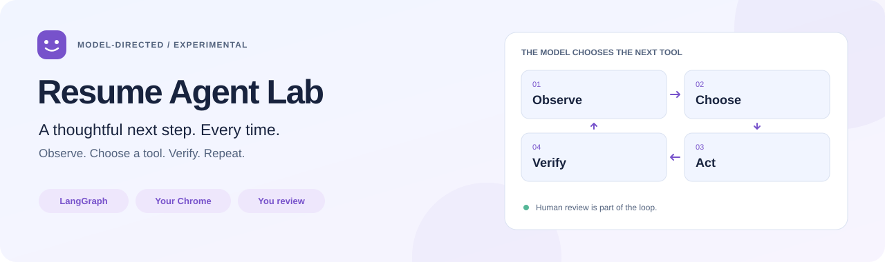
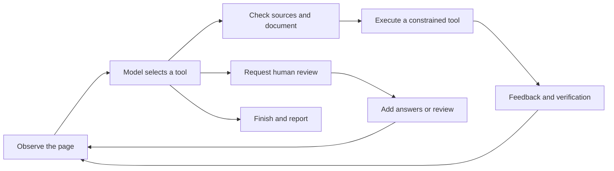

<div align="center">

# Resume Agent Lab

**A resume assistant that observes, chooses its next step, and asks for help.**

Your everyday Chrome. A model choosing tools. LangGraph keeping track.

[简体中文](README.md) · [English](README.en.md)


[Quick start](#quick-start) · [Try a form](#try-it) · [How it works](#how-it-works) · [FAQ](#faq) · [Authors](#authors)

</div>

<picture>
  <source media="(prefers-color-scheme: dark)" srcset="docs/assets/hero-dark.svg">
  
</picture>

## 👋 When the form changes, the next step should too

A resume page rarely unfolds exactly as expected. A school needs a search first. New fields appear after adding an experience. A dropdown is still loading. Or an answer is simply missing from your profile.

This experiment lets the model use the current page and previous feedback to decide **whether to inspect a control, fill a field, add an experience, wait briefly, or ask you for information**. It observes again after each action before choosing the next one.

**An experimental project you can run from source.** Real Chrome filling is connected, while complex controls and cross-site coverage are still being improved. Review the result; a successful action does not mean the entire resume is complete.

## ✨ Built to work with you

| Capability | What you get |
| --- | --- |
| 🧠 Model-directed tools and ordering | The next action responds to page feedback |
| 🔎 Inspect unfamiliar controls | Observe supported options, widget protocols, and readiness |
| 📚 Grounded profile access | Values come from reliable source paths; missing independent answers require your input |
| 🧾 Readable execution records | Brief decision summaries, selected tools, feedback, and unfilled reasons |
| 🙋 Pause and resume | Add information or review the page, then resume with a fresh observation |
| 🧭 Original-document binding | Switching tabs keeps the task on its page; refreshing or navigating ends the old task |

The editor supports personal details, family members, multiple experience records, languages, certificates, awards, competitions, and custom answers. The default mode is **overwrite all**, with **fill empty fields only** also available.

### Which project should I use?

| What you want today | Project |
| --- | --- |
| A usable filling extension with more accumulated real-form fixes | [Resume Autofill](https://github.com/SprayWaterXCW/resume-autofill-extension) |
| To try, understand, or extend model-directed form filling | **Resume Agent Lab · this repository** |

The projects use separate extensions, profile stores, and ports. Export your own profile backup and import it into the other project when needed.

<a id="quick-start"></a>
## 🚀 Quick start

You need **Node.js 22+, Chrome 116+**, and a model API supporting OpenAI-compatible tool calls. **macOS** is the primary verified environment.

### 1. Clone, build, and start

```bash
git clone https://github.com/SprayWaterXCW/resume-agent-lab.git
cd resume-agent-lab
npm ci
npm run build:extension
npm start
```

The service runs at **[127.0.0.1:4175](http://127.0.0.1:4175/)**. Keep this terminal open while using `npm start`; press `Ctrl+C` to stop it.

### 2. Configure your model in the browser

Open the [model settings page](http://127.0.0.1:4175/), then enter and save:

| Setting | What to enter |
| --- | --- |
| Base URL | Your provider's OpenAI-compatible API base URL |
| Model | An actual model ID offered by that provider |
| API Key | Your own model API key |

Use a base URL rather than the complete `/chat/completions` path. You can test a tool call after saving; the test calls the model and may incur charges.

### 3. Load the extension and add your profile

1. Open `chrome://extensions` and turn on **Developer mode**.
2. Choose **Load unpacked** and select this repository's `agent-extension` folder.
3. Pin **Resume Agent Lab · 模型自主决策**.
4. Open the extension and choose **“编辑资料” — Edit profile**. Save your details or import your own backup.

<a id="try-it"></a>
## 🧪 Start with a friendly practice form

Open the **[fictional recruitment form](http://127.0.0.1:4175/practice)**. In the extension, click **“载入虚构测试资料” — Load fictional test profile**, followed by **“开始填写此标签页” — Start filling this tab**.

The profile has two education records. The page starts with just one card and includes a question that has no profile answer. Watch how the agent selects tools, adds a card, and handles the missing information.

> [!NOTE]
> Loading the fictional profile replaces the active profile in this extension. Export an existing personal profile from the editor first; import your backup to restore it after practice.

### Then try your real form

**Check your personal profile → Open a resume editor → Choose a mode → Start → Read the execution record → Review the result.**

For missing answers, open **“查看未填写原因” — View unfilled reasons** and use **“补充本页缺失资料” — Add missing profile information**. When a task requests review, complete it and click **“已核对，继续 Agent” — Reviewed, continue Agent**. The agent observes the original page again before continuing.

**You own the final step.** The agent has no tools for saving, submitting, applying, signing, accepting declarations, or arbitrary navigation. You can use the website normally. Refreshing, navigating, or closing the original document ends that task.

<a id="how-it-works"></a>
## 🧠 How the agent chooses its next step

Each turn gives the model a page observation, a reliable source catalog, previous tool feedback, and remaining budgets. It selects an action from an explicit tool registry. The program validates arguments, source evidence, and document identity, then executes and observes again. **LangGraph manages the loop, state, and human interruption; the model chooses tools and ordering.**



The runtime refreshes observations automatically. The model can choose nine tools: `inspect_field`, `plan_fields`, `fill_field`, `retry_field`, `add_entry`, `audit`, `wait`, `request_review`, `finish`.

[Browser Use](https://github.com/browser-use/browser-use) informs the action loop, structured outputs, tool feedback, and page-change checks. This project's real form runtime uses its own Chrome bridge and JavaScript LangGraph implementation.

<a id="faq"></a>
## 💬 Good questions

<details>
<summary><strong>Why does a Chrome extension need a local service?</strong></summary>

Chrome observes and operates the page; the local Node.js service runs model calls and LangGraph state. Run `npm start` before using the extension. This project uses port 4175; the companion extension uses 4174.

</details>

<details>
<summary><strong>How are my profile and API key used?</strong></summary>

Profile values stay in the Chrome-local ledger and are resolved by the selected field executor. Model decisions use page labels, structure, options, and the source-path catalog, without real resume values. The API key is stored locally in `.local/config.json`; `.local` and `.env.local` are ignored by Git. Your chosen provider handles model requests and sets any charges and network requirements.

</details>

<details>
<summary><strong>Why are some fields still empty?</strong></summary>

Check the unfilled reasons: an independent answer may be missing, a source ambiguous, a control not ready, or execution unverified. The agent can choose inspection, waiting, retries, or review, but cannot guarantee recovery for every widget. Special components, iframes, Shadow DOM, and uploads need further work. Readback also does not prove server acceptance; inspect the website's own result.

</details>

<details>
<summary><strong>Do the records show the model's full reasoning?</strong></summary>

They show brief model decision summaries, selected tools, execution feedback, and program verification. They help you follow a task without exposing the model's private chain of thought.

</details>

<details>
<summary><strong>How do I update the project?</strong></summary>

Run `npm ci` and `npm run build:extension`, reload the extension in Chrome, and restart the service. Model settings and profiles remain in their respective local stores. Export your profile before migrating to another computer.

</details>

<a id="authors"></a>
## ✍️ Authors & development partners

**SprayWaterXCW × Codex**: learning by building, we are extending a useful resume-filling plugin into an agent that chooses its next step from page feedback.

| Author | Contribution |
| --- | --- |
| **[SprayWaterXCW](https://github.com/SprayWaterXCW)** · Creator, author & maintainer | Product direction, learning goals, real recruitment-site testing, feedback, and keeping development focused on the agent |
| **Codex (OpenAI)** · AI co-author & development partner | Research into reference projects, agent architecture, tools, debugging, tests, documentation, and technical explanations |

More partners are welcome. [GitHub Contributors](https://github.com/SprayWaterXCW/resume-agent-lab/graphs/contributors) is generated from account-linked commits; the table above also credits AI collaboration on this project.

## 🛠️ Keep learning, or build with us

| Explore | Start here |
| --- | --- |
| From workflow to agent | [Lesson one](docs/lessons/01-from-workflow-to-agent.md) |
| Browser Use patterns and implementation differences | [Architecture comparison](docs/browser-use-comparison.md) |
| Readiness, feedback, and missing information | [Lesson two](docs/lessons/02-browser-readiness-and-tool-feedback.md) · [Lesson three](docs/lessons/03-control-inspection-and-profile-review.md) |
| Upcoming capabilities | [Roadmap](docs/roadmap.md) |
| Development and verification scope | [Development history](docs/development-history.md) · [Reports](reports/) |
| Code provenance and references | [Source notes](docs/source-provenance.md) |

The detailed documents linked above are currently in Chinese.

```bash
npm test
npm run demo:scripted
```

These checks use fictional profiles and test models. `npm run eval:live` calls your configured real model and may incur charges. Passing tests does not replace real-site verification. `verify:baseline` compares a local historical plugin archive and requires its directory; it is not needed for a standalone clone.

[Open an issue](https://github.com/SprayWaterXCW/resume-agent-lab/issues) with a sanitized record or a fictional reproduction, or contribute a concrete control improvement. Reused code retains its original GPL-3.0 license in [src/vendor/formfill](src/vendor/formfill/README.md). The banner is a workflow illustration.
