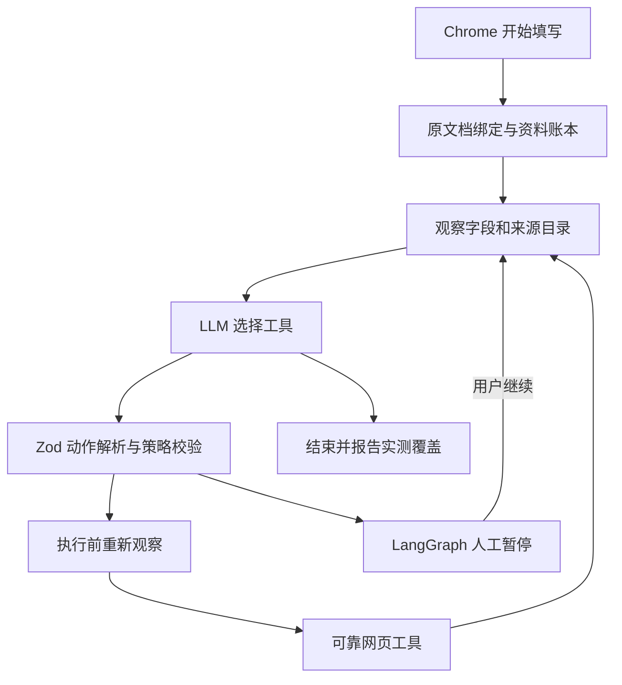

# Resume Agent Lab

独立的简历填写 Agent 实验项目。当前版本 **0.1.7**：模型决定下一项工具，LangGraph 管理状态和循环；支持主动检查控件、逐项未填写原因和暂停后补资料，区分页面控件未初始化与资料缺失。年薪投影与观察协议共享类型定义；首次观察失败保留脱敏的阶段与校验位置。

本项目目录：`~/Downloads/ARIS/RESUME_AGENT_LAB`。已经可用的插件基线仍在 `../RESUME_AGENT`，Mac 安装工程仍在 `../RESUME_FILL_MAC`。本项目没有复制你的资料库或 API 配置，也没有修改这两个目录。

## 先理解我们改了什么

以前的真实网页运行：程序确定「规划、遍历字段、添加、复查」的顺序，LLM 提供映射。

现在的真实运行入口：每轮模型看到当前字段、可靠资料路径、上轮操作结果和剩余预算，选择一个工具。工具完成后重新观察，再把结果交给模型。LLM 可以决定填写、添加、重试、复核、等待或暂停的顺序。

LangGraph 的外层循环和安全限制仍由代码定义。Agent 的自主性来自**工具选择和顺序由模型决定**。把状态图画出来或装上一个库，本身不足以证明这一点。

本项目参考 Browser Use 的动作循环、结构化输出、结果反馈与页面变化校验。当前使用自己的普通 Chrome 工具桥接；真实网页入口没有调用 Python Browser Use SDK。

## 启动与使用

需要 Node.js 22 或更高版本、普通 Chrome。本机已有这些环境。另一个 Mac 的稳定插件仍使用之前的 Mac 安装包；这个实验项目暂时采用开发方式运行。

```sh
cd ~/Downloads/ARIS/RESUME_AGENT_LAB
npm install --cache /private/tmp/resume-agent-lab-npm-cache
npm run build:extension
npm start
```

打开 [设置与学习面板](http://127.0.0.1:4175/)。服务默认只监听 `127.0.0.1:4175`。

1. 在设置网页填写自己的 Base URL、模型名称、API Key，保存后可测试一次工具调用。
2. Chrome 打开 `chrome://extensions`，开启开发者模式，加载本项目的 `agent-extension` 文件夹。
3. 固定扩展 **Resume Agent Lab · 模型自主决策**，打开其「编辑资料」网页填写资料，或导入已有插件导出的资料备份。
4. 打开目标简历表单，点击这个实验扩展的 **开始填写此标签页**。默认全部覆盖，也可选只填空白。
5. 在扩展中查看「模型选择 / 执行 / 反馈」记录。任务请求人工核对时，可以停止，也可以「已核对，继续 Agent」。继续时会重新观察原文档。

原插件与实验扩展有独立 ID、独立资料库和服务端口。使用时通过名称选择对应入口。

### 先在虚构招聘页面体验

打开 [虚构招聘网页](http://127.0.0.1:4175/practice)，在这个页面打开实验扩展，点击「载入虚构测试资料」，再点击正常的「开始填写此标签页」。虚构资料有两段教育经历，页面最初只有一张教育卡片，还有一个资料未提供的问题。

页面显示「业务状态已接收字段数」，这个状态通过 input/change 事件更新，帮助观察输入框显示与页面状态之间的区别。它不连接招聘服务器，也不证明真实网站保存或提交会接受字段。

### 行为边界

- 模型没有提交、投递、保存、签名、勾选声明、跳转、任意点击或执行任意脚本的工具。
- 网页按钮和网络请求仍可由你正常使用。
- 切换标签页后任务继续操作启动时的标签页。原文档被刷新、跳转或关闭后任务停止，旧动作不会重放。
- 每项写入来自已验证的资料路径。缺少信息会明确保留空白；缺少资料不清空已有内容。
- 同一写入最多尝试两次，默认最多 120 轮决策、200 次写入尝试、20 次添加。
- 请求重试失败控件、添加经历和重新规划都由模型选择；程序只执行获准的动作。

## 已实现的结构



| 组件 | 代码 | 职责 |
| --- | --- | --- |
| Agent 状态图 | `src/agent/graph.mjs` | 状态、条件边、循环、检查点、人工中断 |
| 动作模型 | `src/agent/model.mjs` | 每轮真实 LLM 工具调用 |
| 工具契约 | `src/agent/tools.mjs` | 九类工具、参数格式、批量输出兼容 |
| 策略校验 | `src/agent/policy.mjs` | 可靠来源、已完成凭据、预算、过期观察 |
| Chrome 桥接 | `service/bridge.mjs` | 本地 WebSocket 与反向 RPC |
| 浏览器入口 | `agent-extension/src/worker.js` | 文档归属、私有资料、实际工具执行 |
| 填写工具 | `agent-extension/src/real-tab.js` 等 | 复用 0.7.28 控件和页面事件提交实现 |
| 资料与映射校验 | `src/core` | 资料证据、经历索引、字段语义和规划契约 |

模型可能一次返回多项工具调用。最多接受八项，全部检查格式；当前只执行模型返回的第一项，其他动作明确记录为延后。后续动作需要新的观察和新的模型选择。

## 验证方法与范围

```sh
npm test
npm run demo:scripted
npm run eval:live
npm run verify:baseline
```

- `npm test`：Agent 边界与状态、人工中断、工具反馈、本地服务和 WebSocket 的自动检查。
- `demo:scripted`：明确使用脚本模型替身，检验控制结构；结果不会标成 LLM 成绩。
- `eval:live`：使用设置页保存的模型，运行同一个虚构元数据环境。会发出真实 API 请求；没有操作 Chrome 或招聘服务器。
- `verify:baseline`：对原插件归档中的 206 个文件比对 SHA-256，确认保留的基线未被实验工作改动。

2026-10-07 首轮记录详见 `reports/milestone-01.md`。真实模型在虚构环境中填写六个有来源的字段，遇到强制失败后选择了重试，还添加并填写了第二段教育经历。

随后在普通 Chrome 的真实招聘页通过正常工具栏入口复测，修复了页面长期 `loading` 时启动挂起、原生单选问题重复建模和下拉选项匹配问题。早期真实覆盖见 `reports/chrome-startup-0.1.4.md`，缺失分类见 `reports/chrome-gap-repair-0.1.5.md`，最新就绪诊断和暂停实测见 [0.1.6 报告](reports/chrome-gap-repair-0.1.6.md)。最新真实运行在 55 个字段中核验写入 20 项，2 项有资料但未完成，33 项缺少独立答案或来源待核对，并保持人工暂停。这属于真实填写链路的部分验证；没有执行招聘网站的保存、下一步或提交，不能据此宣称网站服务器已接收完整简历。

### 补充网页缺少的答案

扩展的“查看未填写原因”区分已有资料未核验、执行失败、页面控件未初始化、字典未加载、日期精度不足和缺少独立答案。点击“补充本页缺失资料”可以打开带问题清单的资料编辑器。教育经历增加校区；求职偏好增加独立年薪、可实习日期、轮班、无尘车间、岗位调剂、职业规划等配置。陌生问题可建立带题目原文的自定义问答草稿，答案由用户填写和保存。

Agent 暂停后可以修改资料，点击“已核对，继续 Agent”恢复同一次 LangGraph 运行。资料版本改变会使旧计划和核验结果失效，Agent 重新观察和规划。当前暂停恢复依赖服务进程中的内存检查点，重启服务需重新开始。

0.1.7 修复了补充独立年薪后首次观察失败的问题。根因、诊断边界及正常工具栏复测见 [启动协议修复报告](reports/chrome-observation-contract-0.1.7.md)。

## 隐私与配置

简历值留在扩展的本地资料账本中。Node 服务、模型输入和 LangGraph 状态只处理字段元数据、资料路径与操作凭据。设置网页不会读回密钥，日志不会保存密钥或原始模型响应。

模型设置位于本项目 `.local/config.json`，目录权限 0700、文件权限 0600；这是本地权限保护，尚未使用 macOS Keychain 加密。`.local`、`.env.local` 和实时评估报告已加入 Git 忽略。

检查点使用 LangGraph `MemorySaver`。同一进程和浏览器连接中的人工暂停可以恢复；服务重启、连接中断后不能续跑。下一阶段将讨论持久检查点与重新绑定文档的协议。

## 一边做一边学

- `docs/lessons/01-from-workflow-to-agent.md`：本阶段详细讲解。
- `docs/lessons/02-browser-readiness-and-tool-feedback.md`：真实网页就绪、问题与选项建模、工具反馈和复核分层。
- `docs/lessons/03-control-inspection-and-profile-review.md`：控件检查、缺失资料分类、组件工具与人工补充恢复。
- `docs/browser-use-comparison.md`：与 Browser Use 的源码逐项对照和后续差距。
- `docs/roadmap.md`：分阶段实施与验收标准。
- `docs/source-provenance.md`：复用代码、冻结基线与调研版本。

下一阶段继续完善真实控件覆盖、规划上下文管理与页面业务状态验证，再引入跨进程持久恢复与更多跨站评估案例。
