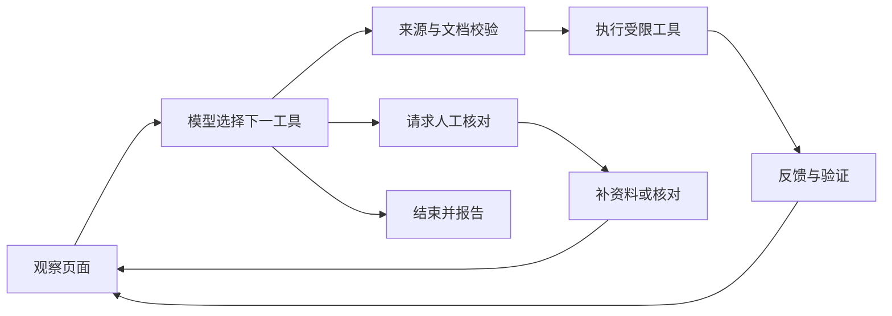

<div align="center">

# Resume Agent Lab

**一个会观察、选择下一步，也会请你帮忙的简历助手。**

在普通 Chrome 中运行，用 LangGraph 管理状态，让模型决定接下来做什么。

[简体中文](README.md) · [English](README.en.md)


[快速开始](#quick-start) · [试一张表](#try-it) · [Agent 如何工作](#how-it-works) · [常见问题](#faq) · [作者](#authors)

</div>

<picture>
  <source media="(prefers-color-scheme: dark)" srcset="docs/assets/hero-dark.svg">
  
</picture>

## 👋 表格变了，下一步也应该跟着变

简历页面常常不会按预想展开：学校需要先搜索、添加经历后字段才出现，某个下拉菜单还没加载好，而你也可能漏填了一项资料。

这个实验项目让模型根据眼前的页面和上一步反馈，决定 **先检查控件、填写一项、添加经历、短暂等待，还是请你补充信息**。执行后重新观察，再决定下一步。

**目前是可从源码运行的实验版。** 已接通真实 Chrome 填写链路，复杂控件与跨网站覆盖仍在完善。每项结果都需要检查，不能把一次成功动作当作整张简历已完成。

## ✨ 一个更会配合你的助手

| 能力 | 使用时能感受到什么 |
| --- | --- |
| 🧠 模型选择工具与顺序 | 根据页面反馈决定下一步，而不是照着一份固定填写清单走到底 |
| 🔎 先检查陌生控件 | 观察已支持的选项、控件协议和就绪状态，再决定如何处理 |
| 📚 使用你维护的资料 | 从可靠来源路径取值；缺少独立答案时请你补充 |
| 🧾 可读的执行记录 | 看到简短决策摘要、工具动作、执行反馈和未填写原因 |
| 🙋 暂停后继续 | 请求核对时补齐资料，点击「已核对，继续 Agent」重新观察并继续 |
| 🧭 绑定原页面 | 切换标签页后继续处理原文档；页面刷新或跳转时停止旧任务 |

资料编辑器支持基本信息、家庭成员、多段经历、语言、证书、获奖、竞赛和自定义问答。运行时默认 **全部覆盖**，也可选择 **只填空白**。

### 我该选哪个项目？

| 你现在想做什么 | 项目 |
| --- | --- |
| 使用已经积累较多真实表单修复的填写插件 | [Resume Autofill](https://github.com/SprayWaterXCW/resume-autofill-extension) |
| 观察、学习或扩展模型自主决策的填写 Agent | **Resume Agent Lab · 本仓库** |

两者使用独立的扩展、资料库和端口。可以导出自己的资料备份再导入另一个项目。

<a id="quick-start"></a>
## 🚀 快速开始

准备 **Node.js 22+、Chrome 116+**，以及支持 OpenAI 兼容工具调用的模型 API。目前主要在 **macOS** 上验证。

### 1. 下载、构建、启动

```bash
git clone https://github.com/SprayWaterXCW/resume-agent-lab.git
cd resume-agent-lab
npm ci
npm run build:extension
npm start
```

服务地址是 **[127.0.0.1:4175](http://127.0.0.1:4175/)**。`npm start` 在当前终端运行，请保留这个终端；按 `Ctrl+C` 停止服务。

### 2. 在网页里配置模型

打开 [模型设置面板](http://127.0.0.1:4175/)，填写并保存：

| 项目 | 填什么 |
| --- | --- |
| Base URL | 服务商的 OpenAI 兼容 API 基础地址 |
| 模型名称 | 该服务商提供的实际模型 ID |
| API Key | 你自己的模型密钥 |

Base URL 使用基础地址，避免填完整的 `/chat/completions` 路径。保存后可以测试一次工具调用；测试会请求模型并可能产生费用。

### 3. 加载扩展，准备资料

1. Chrome 地址栏输入 `chrome://extensions`，开启 **「开发者模式」**。
2. 点击 **「加载已解压的扩展程序」**，选择仓库中的 `agent-extension` 文件夹。
3. 固定 **Resume Agent Lab · 模型自主决策**。
4. 打开扩展，点击 **「编辑资料」**，填写并保存资料；也可以导入自己的备份。

<a id="try-it"></a>
## 🧪 先试一张轻松的表

打开 **[虚构招聘表单](http://127.0.0.1:4175/practice)**，在扩展中点击 **「载入虚构测试资料」**，再点击 **「开始填写此标签页」**。

演示资料有两段教育经历，页面最初只有一张卡片，还特意留了一个资料没有提供的问题。你可以看看 Agent 会如何选择工具、添加卡片，以及在哪些地方需要你补充。

> [!NOTE]
> 「载入虚构测试资料」会更换此扩展当前使用的资料。已有个人资料时，请先在编辑器导出备份；试用结束后可导入恢复。

### 然后，再去你的真实表单

**确认个人资料 → 打开简历编辑页 → 选择填写模式 → 开始 → 查看执行记录 → 核对结果。**

需要补资料时，打开 **「查看未填写原因」**，使用 **「补充本页缺失资料」**。若任务进入人工核对状态，完成核对后点击 **「已核对，继续 Agent」**。Agent 会重新观察原页面，不会直接重放旧动作。

**你掌握最后一步。** Agent 没有保存、提交、投递、签名、接受声明或任意跳转的工具。网页原有按钮与网络请求可由你正常使用。刷新、跳转或关闭原页面会结束该页任务。

<a id="how-it-works"></a>
## 🧠 Agent 如何选择下一步？

每轮，模型收到页面观察、可靠资料目录、上次工具反馈和剩余预算。它从明确的工具集合中选一个动作；程序检查参数、来源和文档身份，再执行并重新观察。**LangGraph 管理循环、状态与人工暂停，模型决定工具和顺序。**



运行时会自动刷新观察。模型可选择九种工具：`inspect_field`、`plan_fields`、`fill_field`、`retry_field`、`add_entry`、`audit`、`wait`、`request_review`、`finish`。

本项目参考 [Browser Use](https://github.com/browser-use/browser-use) 的动作循环、结构化输出、工具反馈与页面变化校验。真实填写由本项目的 Chrome 桥接和 LangGraph 运行，采用 JavaScript 实现。

<a id="faq"></a>
## 💬 常见问题

<details>
<summary><strong>为什么扩展装好了，还需要本地服务？</strong></summary>

Chrome 扩展负责观察与操作页面，本地 Node.js 服务负责模型调用和 LangGraph 状态。先运行 `npm start`，再打开扩展。4175 是本项目端口；另一插件使用 4174。

</details>

<details>
<summary><strong>我的资料和 API Key 会怎样使用？</strong></summary>

资料值保存在 Chrome 的本地资料账本中，并在选定字段的执行器内取出。模型使用页面标签、结构、选项和资料路径目录进行决策，不接收真实简历值。API Key 保存在本机 `.local/config.json`；`.local` 与 `.env.local` 被 Git 忽略。模型请求由你选择的服务商处理，费用与网络要求按该服务商计算。

</details>

<details>
<summary><strong>为什么有的字段还是没填？</strong></summary>

看「未填写原因」：可能缺少独立答案、来源存在歧义、控件未就绪，或执行未通过验证。Agent 可以选择检查、等待、重试或请求帮助，但不能保证修复所有页面控件。特殊组件、iframe、Shadow DOM 和上传字段仍需要进一步适配。页面回读正确也不代表服务器已保存，请检查网站自己的结果。

</details>

<details>
<summary><strong>执行记录展示的是完整思维过程吗？</strong></summary>

展示的是模型提供的简短决策摘要、所选工具、执行反馈和程序验证结果，方便你理解与追踪一次任务。它不会展示模型内部的完整思维链。

</details>

<details>
<summary><strong>源码更新以后怎么重新使用？</strong></summary>

运行 `npm ci` 和 `npm run build:extension`，在 Chrome 扩展页点击「重新加载」，再重启本地服务。模型设置和资料在各自的本地存储中保留；迁移电脑前先导出资料备份。

</details>

<a id="authors"></a>
## ✍️ 作者与开发搭档

**SprayWaterXCW × Codex**：一边做，一边学，把一个实用的简历填写插件逐步拓展成会根据页面反馈选择下一步的 Agent。

| 作者 | 在项目里做了什么 |
| --- | --- |
| **[SprayWaterXCW](https://github.com/SprayWaterXCW)** · 发起人、作者与维护者 | 确定产品方向和学习目标，测试真实招聘网站，提供反馈并推动 Agent 主线 |
| **Codex（OpenAI）** · AI 联合作者与开发搭档 | 调研参考项目，参与 Agent 架构、工具实现、问题排查、测试、文档与技术讲解 |

欢迎更多伙伴加入。[GitHub Contributors](https://github.com/SprayWaterXCW/resume-agent-lab/graphs/contributors) 根据关联账号的提交自动统计；上表也记录了本项目的 AI 协作贡献。

## 🛠️ 想继续学习或参与？

| 方向 | 入口 |
| --- | --- |
| 从工作流到 Agent，理解每一层 | [第一课](docs/lessons/01-from-workflow-to-agent.md) |
| Browser Use 的参考流程与实现差异 | [架构对照](docs/browser-use-comparison.md) |
| 控件观察、反馈与缺失资料 | [第二课](docs/lessons/02-browser-readiness-and-tool-feedback.md) · [第三课](docs/lessons/03-control-inspection-and-profile-review.md) |
| 计划中的能力 | [路线图](docs/roadmap.md) |
| 历史开发与验证范围 | [开发历史](docs/development-history.md) · [验证报告](reports/) |
| 代码来源与引用 | [来源说明](docs/source-provenance.md) |

```bash
npm test
npm run demo:scripted
```

这些检查使用虚构资料与测试模型；`npm run eval:live` 则调用你配置的真实模型，可能产生费用。测试通过不能代替真实网站验收。`verify:baseline` 是本地归档对照工具，需要历史插件目录，独立克隆本仓库时无需运行。

欢迎 [提交问题与建议](https://github.com/SprayWaterXCW/resume-agent-lab/issues)，或从一个具体控件的复现开始贡献。复用代码的原始 GPL-3.0 许可证保留在 [src/vendor/formfill](src/vendor/formfill/README.md) 中；横幅是流程示意图。
