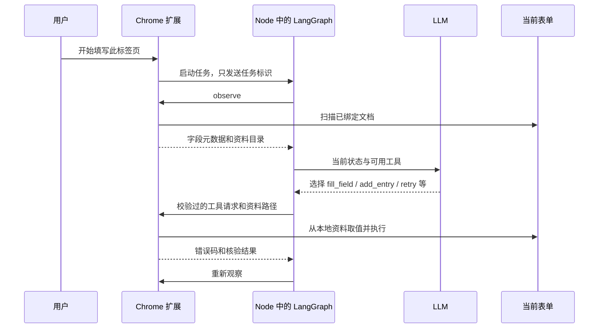

# 第 1 课：从程序安排步骤，到模型选择工具

这一课对应 Agent Lab 的第一个里程碑。先理解控制权发生了什么变化，再理解 LangGraph、工具调用和浏览器桥接分别负责什么。

## 1. 这一步在整体中的位置

一个能在简历网站工作的 Agent 至少需要四层：

1. **任务与资料**：知道用户要填简历，并知道哪些信息有可靠来源。
2. **决策**：根据当前页面与上次结果，选择下一项动作。
3. **工具**：找到控件、写入、触发页面事件、选择选项和增加经历。
4. **验证与状态**：知道动作是否生效，保留已完成凭据，在变化或失败后继续判断。

旧项目对第 1、3、4 层已有大量实际修复。我们此次主要改变第 2 层，同时把循环、状态和人工暂停迁入 LangGraph。可靠网页工具继续为新决策器提供执行能力。

这解释了为什么需要先保留可用插件，再建独立目录：决策器变化会影响动作顺序、请求次数、错误恢复和完成条件，需要单独验收。

## 2. 工作流与 Agent 到底有什么区别

可以把旧运行方式简化成：

```text
程序扫描网页
LLM 提议整页字段映射
程序校验映射
程序按字段列表逐个填写
程序寻找缺少的经历并添加
程序按预先写好的条件重新规划或重试
程序复核和结束
```

这里有 LLM、有工具、有循环，已经具有很多 Agent 组件，但程序安排了主要业务步骤。模型的主要任务是解决语义映射。

新的运行方式是：

```text
读取当前页面和已完成凭据
把页面、资料目录、上次工具结果交给 LLM
LLM 选择下一项工具与目标
程序检查这个动作能否执行
工具执行并返回结果
重新观察页面
再次让 LLM 选择
```

同一张表单，模型可以先填基本信息，也可以先加第二段教育经历。失败后，模型可以先重试失败控件，也可以先填其他字段、复核或请用户处理。

这是一种 **受约束的工具调用 Agent**。约束限定它的权限；工具顺序和恢复方向由模型选择。它仍运行在代码定义的外层循环里，这符合实际 Agent 系统的工程方式。

官方 [Workflows and agents](https://docs.langchain.com/oss/javascript/langgraph/workflows-agents) 将预定代码路径与动态选择过程和工具使用的 Agent 区分开。Browser Use 的 Agent 源码提供了一个具体的浏览器实现参照。

## 3. 为什么现在仍然是插件入口

插件提供的是一个方便的界面和权限入口：用户在自己的普通 Chrome 中选择正在填写的标签页，点击开始。它可以保留登录状态，并使用 Chrome 的 activeTab 和 scripting 能力操作这张表单。

运行架构如下：



关键是：Agent 的状态图和模型调用运行在 Node 服务，扩展负责私有资料与网页工具。是否为 Agent，要看决策机制；插件是它与浏览器交互的载体。

代码对应 `service/bridge.mjs` 和 `agent-extension/src/worker.js`。

## 4. LangGraph 在这里负责什么

LangGraph 是状态执行框架。我们实际安装并调用了它的 API：

```js
import {
  StateGraph, StateSchema, MemorySaver,
  START, END, interrupt, Command
} from "@langchain/langgraph";
```

### State：任务的当前事实

State 保存当前观察、已校验的映射、模型选择、写入凭据、错误反馈、次数与预算。这些信息使下一轮知道上一轮发生了什么。

例如：某字段有可靠来源，但第一次写入回读失败。State 应同时记住字段、来源、失败码和尝试次数。模型看到这些信息后才有依据选择 `retry_field`。

State 不是任意资料仓库。简历值和模型密钥没有放进去。资料值留在浏览器账本，模型对象与浏览器对象保存在运行时闭包中。

### Node：执行一种责任

本阶段有这些节点：

| 节点 | 作用 |
| --- | --- |
| observe | 读取原文档，更新当前字段和凭据，必要时使旧计划失效 |
| decide | 调用 LLM，取得它选择的工具 |
| policy | 校验来源、目标、已完成状态、次数与预算 |
| execute | 对所选工具执行一次调用，并记录结果 |
| human_review | 暂停并等待用户继续或停止 |
| finish | 根据实际观察与凭据计算结果 |

### Edge：状态如何流动

固定边表达必须完成的运行步骤。条件边检查 State，决定进入执行、再次决策、人工暂停或结束。

框架决定如何安全地组织循环；LLM 决定业务上选哪个工具。模型提出 `add_entry`，程序不会自行把它替换成固定顺序的 `fill_field`。如果该动作不符合约束，就返回拒绝码，供下一轮模型重新选择。

官方 [Graph API](https://docs.langchain.com/oss/javascript/langgraph/graph-api) 介绍 State、节点、边和状态更新。可以结合 `src/agent/graph.mjs` 阅读这些概念。

## 5. Tool Calling：把模型建议变成可执行的结构

自然语言建议很容易含糊，比如「把学校填上」。工具调用需要明确目标和来源，形状类似：

```json
{
  "name": "fill_field",
  "arguments": {
    "snapshotId": "当前页面快照标识",
    "fieldId": "field-3",
    "sourcePath": "educations.0.school",
    "evaluation": "uncertain",
    "nextGoal": "填写第一段教育经历的学校"
  }
}
```

这里没有学校的真实名称。执行器根据 `sourcePath` 从私有资料账本取值。模型能选择来源，却不能编造实际写入文本。

`evaluation` 和 `nextGoal` 是给用户看的简短决策摘要。它们帮助理解 Agent 在做什么，不能替代工具核验，也不代表展示模型的隐藏思维过程。

模型选择的工具集合如下：

| 工具 | 输入要点 | 返回的证据 |
| --- | --- | --- |
| plan_fields | 当前快照 | 经过来源、语义和经历索引校验的映射，或规划错误 |
| fill_field | 字段 ID、可靠资料路径 | 写入及页面状态核验结果 |
| retry_field | 已失败字段与相同来源 | 使用已有另一种事件提交方式的结果 |
| add_entry | 已确认缺记录的分组 | 增加一张卡片的核验结果 |
| audit | 当前已写入凭据 | 写入是否仍保留、组件状态是否一致 |
| wait | 100～1000 毫秒 | 等待后进入重新观察 |
| request_review | 人工处理原因 | LangGraph 中断与待核对状态 |
| finish | 当前快照 | 结束本轮并报告覆盖；没有页面按钮动作 |

`plan_fields` 仍会使用一个专业的字段映射模型调用。Agent 可以调用一个包含内部 LLM 的专门工具；关键是它没有被程序强制按某个整页流程运行。

## 6. Zod 与 JSON Schema 各自做什么

JSON Schema 告诉模型每个工具有哪些参数、哪些必填。Zod 则在本地检查收到的结果是否符合规则。

它们处理的是同一个契约的两个方向：给模型说明格式；对模型输出进行实际验证。

参数格式合法还不意味着动作获准。`personal.invented` 可以是格式合法的字符串，但它没有出现在资料目录，也没有通过映射校验，因此不能执行。

所以有两层检查：

1. **格式检查**：工具名称、参数类型、未知参数、调用数量。
2. **语义与权限检查**：来源可靠、字段当前可写、经历索引正确、快照有效、预算未超出。

对应 `src/agent/tools.mjs` 与 `src/agent/policy.mjs`。这让错误有明确的阶段和错误码，方便日志定位。

## 7. 为什么模型的成功评价不能用作成功计数

模型可能认为自己成功了，输入框也可能显示内容，但页面组件没有接收到，甚至保存后值消失。这个问题在旧项目里已经出现过。

当前成功数来自工具凭据和复核结果。我们区分：

- 输入框回读一致。
- 页面组件状态一致。
- 招聘服务器真正接受和保存信息。

前两类可以由现有工具提供部分证据。第三类需要真实网站业务层面的验收，本阶段没有自动提交或保存工具，因此结果明确标注 `serverAcceptance: not_checked`。

模型说成功，但工具回读失败，就把失败结果送回下一轮。后续复核发现值丢失，要撤回之前的成功计数。

这就是 Agent 的**环境反馈**：下一轮依据执行后的观察作判断，不能只依据自己的意图。

## 8. 页面快照为什么需要在执行前再检查

模型调用期间，用户或网站可能改变页面。学校字段的原始节点可能被重新渲染，添加经历也会改变字段数量。

我们在模型返回后再次观察。若当前快照与模型看到的快照不同，这项旧动作取消，反馈 `STALE_OBSERVATION`。

添加经历后结构改变，旧映射作废。下一轮模型应选择重新规划，新的卡片得到新的来源校验。可靠的历史凭据通过唯一语义目标匹配保留；它们不自动给旧计划授予执行权限。

Browser Use 的动作序列也有页面变化检查。我们以更窄的表单工具实现同样的安全原则。

## 9. 真实模型暴露的批量调用问题

初次真实模型运行失败了。新增格式日志显示：模型接口在 `parallel_tool_calls: false` 时，仍返回 2～4 个调用。

这是格式和执行协议之间的问题。修复方式是：最多接收八项；全部严格检查；执行模型返回序列的第一项；其他项记录为延后，进入新的观察与决策。

这保留了模型选择，同时防止后续调用操作变化后的页面。当前会多用一些模型请求。未来可以参照 Browser Use 的 `multi_act()`，实现小批次内的逐项验证与页面变化终止，降低成本。

## 10. Checkpoint 与 Human in the Loop

**Checkpoint** 是某个执行阶段的状态快照。它能记录任务正在等待哪个节点、已写入哪些目标以及下一步有哪些条件。

LangGraph 的 `MemorySaver` 把检查点放在内存。它支持本阶段的人工暂停与继续，但服务重启就丢失。这一点不能说成持久恢复已完成。官方 [Persistence](https://docs.langchain.com/oss/javascript/langgraph/persistence) 明确说明了 MemorySaver 的边界。

**Human in the Loop** 表示模型在需要人处理时，把任务暂停下来。我们使用：

```js
const response = interrupt({ reason: "需要核对" });
// 用户在扩展中选择继续后：
await graph.invoke(new Command({ resume: "continue" }), config);
```

同一个 `thread_id` 指向同一任务的检查点。恢复时会重新进入暂停节点，随后重新观察页面。提交权限不会因此改变。

官方 [Interrupts](https://docs.langchain.com/oss/javascript/langgraph/interrupts) 还提醒：恢复会从暂停节点开头重新执行。因此暂停前不应放不可重复的页面写入。本项目的人工作用节点只负责暂停，网页动作放在单独的执行节点里。

## 11. 为什么要有两种评估

脚本模型可以严格指定先添加、先填写或某轮提出非法动作，用来检验控制结构、权限和恢复。它没有证明真实 LLM 会怎样决策。

真实模型评估会使用实际 API，让模型自己选工具。当前评估环境仍是虚构元数据模拟器，实际网页工具还要通过 Chrome 验收。

第一次真实运行失败，新增格式诊断后定位到批量调用，修复后真实模型选择了如下序列：

```text
规划
填写基本信息与第一段教育
失败后重试
复核
添加第二段教育
重新规划
填写新卡片
再次复核
结束
```

结果为六个有来源字段得到核验写入，一张教育卡片新增。真实模型发出 13 次动作决策请求，映射适配器发出 3 次 HTTP 请求。详细证据见 `reports/milestone-01.md`。

下一阶段的 Chrome 验收将检验执行器事件、页面业务状态、后台任务和真实页面布局，不把模拟环境的成绩直接换算成真实网站成功率。

## 12. 你现在应掌握哪些知识

按下面的顺序学习，比先记一批框架名称更容易对应到代码：

1. **Agent 控制循环**：观察、模型选择、工具执行、反馈；谁拥有业务步骤的选择权。
2. **工具调用和类型契约**：JSON Schema、Zod、来源约束、非法输出处理。
3. **LangGraph 状态图**：State、Node、Edge、条件分支、State 更新。
4. **状态和记忆**：当前观察、重要失败、已完成凭据；如何减少上下文并防止反复操作。
5. **检查点与人工中断**：MemorySaver、thread_id、interrupt、Command，以及重启恢复的边界。
6. **浏览器工具工程**：Chrome MV3、activeTab、文档绑定、MAIN/ISOLATED 世界、input/change/blur 事件与 WebSocket RPC。
7. **评估与可观测性**：动作轨迹、有效覆盖、失败恢复、token 成本、页面状态与业务层验证。

下一步优先阅读 `src/agent/graph.mjs`。它能把以上概念串起来；随后结合 `tools.mjs` 和 `policy.mjs` 理解模型输出为何必须经过格式、语义和执行前快照检查。
